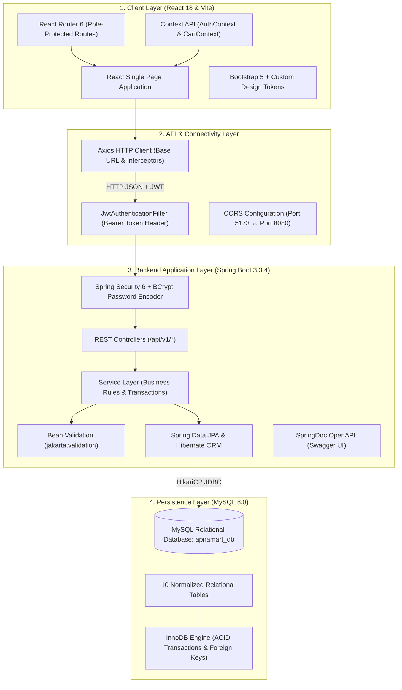
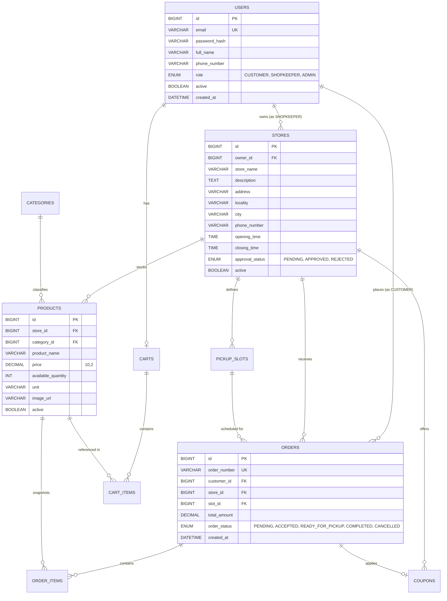

# ApnaMart &ndash; Fresh Groceries, Local Store Catalog, Pre-Order & Pickup

<div align="center">


**Your Neighbourhood. Your Essentials.**  
*A modern full-stack web application connecting local neighbourhood customers with nearby independent kirana stores and department stores.*

[Live Swagger UI](http://localhost:8080/swagger-ui/index.html) &bull; [ER Diagram](docs/er-diagram.md) &bull; [API Documentation](docs/api-documentation.md) &bull; [Test Report](docs/test-report.md)

</div>

---

## 📌 Table of Contents
1. [Overview & Problem Statement](#-overview--problem-statement)
2. [Proposed Solution & Core Features](#-proposed-solution--core-features)
3. [System Architecture & Data Flow](#-system-architecture--data-flow)
4. [Database Design & Entity Relationships](#-database-design--entity-relationships)
5. [Technology Stack](#-technology-stack)
6. [Project Folder Structure](#-project-folder-structure)
7. [Getting Started & Local Setup](#-getting-started--local-setup)
8. [Demo Accounts (Development & Evaluation)](#-demo-accounts-development--evaluation)
9. [REST API Endpoints](#-rest-api-endpoints)
10. [Key Application Screens](#-key-application-screens)
11. [Testing & Quality Assurance](#-testing--quality-assurance)
12. [Security & Business Invariants](#-security--business-invariants)
13. [Contributing & License](#-contributing--license)

---

## 🎯 Overview & Problem Statement

Independent kirana and department stores are the backbone of retail in Indian communities. However, they face steep operational hurdles:
- **Peak-Hour Congestion:** Customers waste 20–40 minutes in long checkout and packing queues during evening rush hours.
- **Inventory Invisibility:** Shoppers visit stores without knowing item availability or stock levels beforehand.
- **Inefficient Order Assembly:** Shopkeepers are forced to manually retrieve individual goods off shelves while shoppers wait impatiently at the counter.
- **Quick-Commerce Disruption:** Corporate delivery aggregators charge exorbitant merchant commissions (18–30%) while threatening the livelihood of local neighborhood stores.

---

## 💡 Proposed Solution & Core Features

**ApnaMart** empowers neighbourhood retail through a **hyperlocal click-and-collect pre-ordering architecture**:

- 🛒 **Single-Store Cart Enforcement:** Prevents mixed orders across stores; interactive conflict modal allows switching stores with 1-click confirmation.
- ⏰ **Capacity-Controlled Pickup Slots:** Customers select guaranteed pickup windows (e.g., *Today, 18:00–19:00*). Live capacity tracking prevents store congestion.
- 📦 **Merchant Packing Workspace:** Shopkeepers view itemized goods checklists (`View Goods & Pack`), check off items as they pack, and update fulfillment stages in real time.
- ⚡ **Atomic Inventory Decrements:** JPA transactional boundaries prevent overselling or race conditions during concurrent pre-orders.
- 🏷️ **Store-Exclusive Coupons:** Shopkeepers offer customized promo codes (percentage or flat discounts) tied to minimum order amounts.
- 🛡️ **Role-Based Security:** Strict Spring Security 6 & JWT architecture separating Customer, Shopkeeper, and System Administrator privileges.

---

## 🏗️ System Architecture & Data Flow



---

## 🗄️ Database Design & Entity Relationships

The relational database is structured in 3NF across 10 tables in MySQL 8.0:



*For comprehensive database schema details, constraints, and relational descriptions, see [docs/er-diagram.md](docs/er-diagram.md).*

---

## 🛠️ Technology Stack

| Layer | Technologies & Libraries |
| :--- | :--- |
| **Backend Core** | Java 21 / 24 LTS, Spring Boot 3.3.4, Spring Web MVC |
| **Security & Auth** | Spring Security 6, JJWT 0.12.6, BCrypt password hashing |
| **Data & Persistence** | Spring Data JPA, Hibernate 6, MySQL 8.0, HikariCP |
| **API Documentation** | SpringDoc OpenAPI 2.6.0, Swagger UI (`/swagger-ui.html`) |
| **Validation** | Jakarta Bean Validation (`@Valid`, `@NotNull`, `@Min`) |
| **Frontend Framework** | React 18, Vite 8 (Hot Module Replacement) |
| **Routing & State** | React Router 6, Context API (`AuthContext`, `CartContext`) |
| **HTTP Client** | Axios 1.7 with JWT Request/Response Interceptors |
| **UI Styling** | Bootstrap 5.3, Bootstrap Icons, Custom CSS Design Tokens |
| **Testing** | JUnit 5, Mockito, Spring Boot Test |

---

## 📁 Project Folder Structure

```text
PROJECT/
├── backend/
│   ├── pom.xml                               # Maven project dependencies & plugins
│   └── src/
│       ├── main/
│       │   ├── java/com/apnamart/
│       │   │   ├── ApnaMartApplication.java  # Spring Boot main entrypoint
│       │   │   ├── controller/               # 9 REST Controllers (/api/v1/*)
│       │   │   ├── dto/                      # Request & Response DTO records
│       │   │   ├── entity/                   # 10 JPA Relational Entities
│       │   │   ├── enums/                    # Role, OrderStatus, ApprovalStatus
│       │   │   ├── exception/                # GlobalExceptionHandler & Custom Errors
│       │   │   ├── repository/               # 7 Spring Data JPA Repositories
│       │   │   ├── security/                 # JwtTokenProvider, JwtFilter, SecurityConfig
│       │   │   └── service/                  # Service interfaces & business implementations
│       │   └── resources/
│       │       ├── application.yml           # Database, JPA, JWT, and Swagger configuration
│       │       └── seed_full_market_catalog.sql # Initial database seed catalog
│       └── test/                             # Automated JUnit 5 test suite
│
├── frontend/
│   ├── index.html                            # HTML5 root template
│   ├── package.json                          # NPM dependencies (React 18, Vite, Bootstrap)
│   ├── vite.config.js                        # Vite bundler configuration
│   └── src/
│       ├── api/                              # Axios client & scoped API modules
│       ├── components/                       # Navbar, Footer, Cards, Steppers, Modals
│       ├── context/                          # AuthContext, CartContext
│       ├── pages/                            # 10 Application Route Pages
│       ├── App.jsx                           # Route declarations & role guards
│       ├── index.css                         # Design system tokens & global styling
│       └── main.jsx                          # React DOM mount point
│
├── docs/
│   ├── er-diagram.md                         # Detailed Entity-Relationship documentation
│   ├── api-documentation.md                  # Comprehensive REST endpoint specification
│   └── test-report.md                        # Verification & test execution report
│
├── .gitignore                                # Git ignore rules for Java, Node & IDEs
└── README.md                                 # Project documentation
```

---

## 🚀 Getting Started & Local Setup

### Prerequisites
- **Java Development Kit (JDK):** Version 21 LTS or newer
- **Apache Maven:** Version 3.8+
- **Node.js:** Version 18+ and `npm`
- **MySQL Database Server:** Version 8.0+

---

### Step 1: Database Setup
Ensure MySQL is running on `localhost:3306`, then create the database:
```sql
CREATE DATABASE apnamart_db;
```
*(Database configuration is located in `backend/src/main/resources/application.yml` or can be overridden via `DB_PASSWORD` environment variable).*

---

### Step 2: Run the Spring Boot Backend
```powershell
cd backend
mvn spring-boot:run
```
- **Backend API Base URL:** `http://localhost:8080`
- **Interactive Swagger UI:** `http://localhost:8080/swagger-ui/index.html`
- **OpenAPI Schema (JSON):** `http://localhost:8080/v3/api-docs`

*On first startup, the data seeder automatically initializes 6 stores, 396+ products, verified demo accounts, categories, and pickup capacity schedules.*

---

### Step 3: Run the React Frontend
Open a new terminal window:
```powershell
cd frontend
npm install
npm run dev
```
- **Application URL:** `http://localhost:5173`

---

## 👥 Demo Accounts (Development & Evaluation)

The login screen features **1-click quick login buttons** to instantly authenticate without manual typing:

| Role | Email Address | Password | Account Details |
| :--- | :--- | :--- | :--- |
| **Customer** | `rahul@apnamart.com` | `Customer@123` | Rahul Sharma (Active order history & pre-orders) |
| **Customer 2** | `priya@apnamart.com` | `Customer@123` | Priya Patel (Secondary test customer) |
| **Shopkeeper** | `vikram@apnamart.com` | `Shop@123` | Owner of **Sharma Kirana Store** (67 products, order queue) |
| **Shopkeeper 2**| `freshmart@apnamart.com`| `Shop@123` | Owner of **Fresh Mart** |
| **Administrator**| `admin@apnamart.com` | `Admin@123` | System Administrator (Analytics & merchant approvals) |

---

## 🔌 REST API Endpoints

All endpoints are standardized under `/api/v1/*` with consistent JSON envelopes:

```json
{
  "success": true,
  "message": "Operation successful",
  "data": { ... },
  "timestamp": "2026-10-21T00:15:00"
}
```

### Public Endpoints
- `POST /api/v1/auth/login` &ndash; Authenticate user & return JWT Bearer token
- `POST /api/v1/auth/register` &ndash; Register new customer or shopkeeper
- `GET /api/v1/stores` &ndash; List approved nearby stores
- `GET /api/v1/stores/{id}` &ndash; Store profile & operational hours
- `GET /api/v1/products/store/{storeId}` &ndash; Live product catalog with categories & stock
- `GET /api/v1/categories` &ndash; Active category classification listing

### Customer Endpoints (`ROLE_CUSTOMER`)
- `GET /api/v1/cart` &ndash; Retrieve active pre-order cart
- `POST /api/v1/cart/items` &ndash; Add product to cart (enforces single-store invariant)
- `DELETE /api/v1/cart/items/{id}` &ndash; Remove line item from cart
- `DELETE /api/v1/cart` &ndash; Clear cart
- `POST /api/v1/customer/orders` &ndash; Place pre-order with slot reservation
- `GET /api/v1/customer/orders` &ndash; Customer pre-order history
- `PATCH /api/v1/customer/orders/{id}/cancel` &ndash; Cancel pending pre-order & restore stock

### Shopkeeper Endpoints (`ROLE_SHOPKEEPER`)
- `GET /api/v1/shopkeeper/dashboard` &ndash; Order counts, total sales, pending metrics
- `GET /api/v1/shopkeeper/orders` &ndash; Store's incoming pre-orders queue
- `PATCH /api/v1/shopkeeper/orders/{id}/status` &ndash; Advance order stage (`ACCEPTED`, `READY_FOR_PICKUP`, `COMPLETED`)
- `POST /api/v1/shopkeeper/products` &ndash; Add new product to store catalog
- `DELETE /api/v1/shopkeeper/products/{id}` &ndash; Soft-delete product
- `POST /api/v1/shopkeeper/slots` &ndash; Define new pickup slot with capacity

### Administrator Endpoints (`ROLE_ADMIN`)
- `GET /api/v1/admin/dashboard` &ndash; Platform overview KPIs
- `GET /api/v1/admin/stores` &ndash; Filter stores by approval status
- `PATCH /api/v1/admin/stores/{id}/approval` &ndash; Approve or reject new store registrations

*For comprehensive API request/response payloads, see [docs/api-documentation.md](docs/api-documentation.md).*

---

## 📱 Key Application Screens

1. **Home Page (`/`):** Hero section, "Shop Nearby" CTA, category explorer chips, featured stores with distance badges.
2. **Store Details & Product Catalog (`/stores/:id`):** Store header, category filter sidebar, price range sliders, product search, and live stock tags.
3. **Pre-Order Cart (`/cart`):** Single-store pre-order enforcement banner, quantity spinners (`- 1 +`), promo code input, and order summary.
4. **Checkout & Slot Selection (`/checkout`):** 4-step progress stepper (`Cart` &rarr; `Pickup Slot` &rarr; `Review` &rarr; `Confirm`), date selector pills, and capacity-tracked time slot cards.
5. **Order Confirmation (`/order-confirmation/:orderNumber`):** Verified order token, pickup schedule countdown, store address, and itemized bill.
6. **Customer Dashboard (`/customer/dashboard`):** 4 metric cards, active order status timeline, order history table, and bill downloads.
7. **Shopkeeper Dashboard (`/shopkeeper/dashboard`):** Store approval status, KPI cards (Total Orders, Pending, Total Sales, Products), incoming order management, and catalog manager.
8. **Admin Dashboard (`/admin/dashboard`):** System overview analytics, 7-day order trend visualizations, and 1-click merchant approvals.

---

## 🧪 Testing & Quality Assurance

Automated backend unit and integration tests validate authentication flows, single-store cart enforcement, atomic stock decrements, and slot capacity guarantees:

```powershell
cd backend
mvn test
```

### Test Coverage Highlights:
- **`AuthServiceTest`:** Authentication tokens, password hashing validation, invalid credential rejection, duplicate email prevention.
- **`OrderServiceTest`:** Single-store cart checks, atomic inventory decrements, capacity overflow prevention, order cancellation stock restoration.

*For full test cases, steps, inputs, and results, see [docs/test-report.md](docs/test-report.md).*

---

## 🔒 Security & Business Invariants

1. **Role-Based Authorization:** Endpoints are strictly protected with Spring Security annotations (`@PreAuthorize("hasRole('ROLE_SHOPKEEPER')")`). Self-assigning `ROLE_ADMIN` during public registration is strictly blocked.
2. **Single-Store Pre-Order Invariant:** Pre-orders are strictly bound to a single merchant. Attempting to add an item from another store triggers an interactive confirmation modal before clearing the prior cart.
3. **Atomic Concurrency Control:** SQL atomic updates (`UPDATE products SET available_quantity = available_quantity - ? WHERE id = ? AND available_quantity >= ?`) prevent overselling under high concurrency.
4. **Historical Record Preservation:** Product names and unit prices are snapshot into `order_items`. Products utilize soft-deletion so past financial records remain immutable.
5. **Idempotent Inventory Restoration:** If an order is rejected or cancelled, reserved product inventory and pickup capacity are safely restored.

---

## 📄 Contributing & License

This project was developed for the **Lab-Completed Web Application / React & Spring Boot Project** under academic submission guidelines.

Licensed under the [MIT License](LICENSE).
